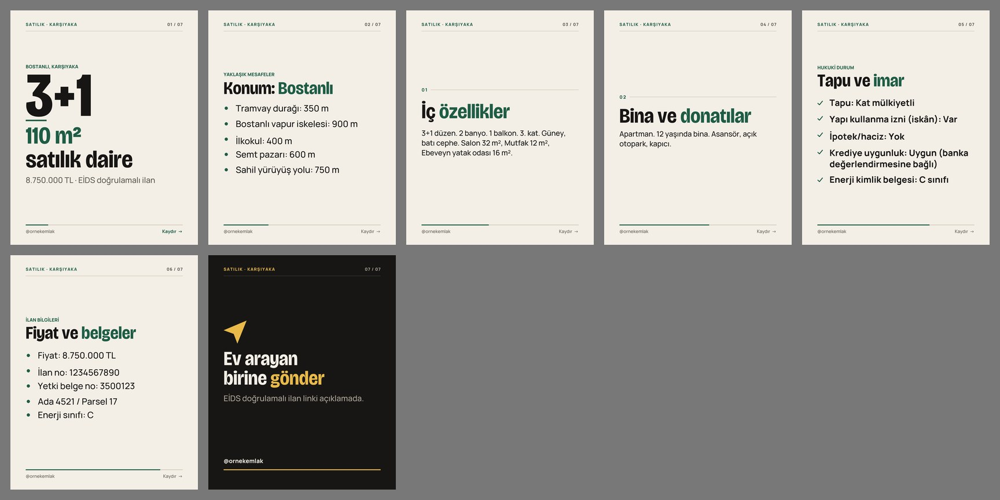

# Emlak İlan Kiti (Claude Code skill)

Taşınmaz bilgilerini bir kez yaz; Claude **Sahibinden, Hepsiemlak ve Emlakjet** için başlık + açıklama + özellik
listesini, **Instagram reels çekim planını** (ekran yazıları, kalıcı fiyat rozeti, son kart, açıklama) ve
**carousel planını** çıkarsın, ilanı yayından önce **EİDS ve Taşınmaz Ticareti Hakkında Yönetmelik** kurallarına göre
denetlesin.

Ücretsiz, MIT lisanslı. Redirhan Studio tarafından hazırlandı. Tamamen yerel çalışır: yayın yok, portal ya da
Instagram girişi yok, ücretli API yok, tarayıcı yok. Yalnız Python standart kütüphanesi.

> **Bu bir hukuki görüş değildir; bilgilendirme amaçlıdır.** Her çıktı bu cümleyle başlar ve biter. Emin olmadığınız
> durumda avukata ya da ticaret il müdürlüğüne danışın.



## Ne yapar?

- **Üç portal için metin.** Kısa başlık (konum + oda + tür + tek özellik), bölümlü açıklama, özellik kutuları ve
  form alanları tablosu. Metin yalnız girdiğin bilgilerden kurulur; özellik uydurmaz.
- **Zorunlu bilgiler bloğu.** Yetki belgesi no, belgedeki unvan, il/ilçe/mahalle, ada/parsel, iletişim, enerji sınıfı
  ve EİDS satırı her açıklamada (Yön. m.14/2-i). Açık adres hiçbir yere yazılmaz.
- **Instagram.** Odalara göre reels çekim listesi (kamera hareketi + ekran yazısı + süre), tüm video boyunca
  `fiyat · EİDS onaylı ilan linki açıklamada` rozeti, son kart, kapak, açıklama (fiyat + EİDS linki + yetki belge no),
  story metni. Yapay zekâ ile döşenmiş fotoğraflarda ekran beyanı.
- **Carousel planı.** [Türkçe Carousel Üretici](https://github.com/redirhan/turkce-carousel) formatında 6-8 slayt:
  kapak, konum, iç özellikler, bina, tapu, "fiyat ve belgeler", paylaş çağrısı.
- **Denetim raporu.** 42 kural; her biri madde numarası, kaynak linki, belge tarihi, okunma tarihi ve güven düzeyiyle.
  Sorun varsa metinler "TASLAK — YAYINLAMAYIN" başlığı ve `[GEREKLİ]` yer tutucularıyla yazılır; sorunlu ifadeler
  ("imar gelecek", "fiyat için DM", girilen bilgiyle çelişen "deniz manzaralı") metne alınmaz.
- **Reklam kuralları.** Belgeli fiyat düşüşü, yapay zekâ görseli ya da iş birliği varsa ücretsiz
  [Reklam Etiketi Kontrolü](https://github.com/redirhan/reklam-etiketi) için `reklam_kontrol.yaml` yazar; skill
  kuruluysa çalıştırır.

## Neyi denetler?

| Konu | Örnek bulgu |
|---|---|
| EİDS | İlan yayınlama izni yok; sosyal medyada EİDS linki ya da fiyat yok; görsel komşu parselden |
| Zorunlu bilgiler | Yetki belge no, ada/parsel, iskân, tapu cinsi, oda m²'leri, durak mesafesi eksik |
| Fiyat | Peşinat fiyat gibi gösterilmiş; dövizle fiyat; "1 TL" yem fiyat; fiyat artışı; belgesiz "fiyat düştü" |
| Hizmet bedeli | Satışta %4, kirada 1 aylık kira (+ KDV) aşılmış; gösterme ücreti |
| Yetki | Yazılı sözleşme yok; yetki süresi bitmiş ya da 30 gün içinde bitiyor |
| Yanıltıcı ifade | "Garantili kira getirisi", "imar gelecek"; "iskânlı" ama iskân yok; hisse oranı gizli |
| Görsel | Sanal mobilya beyanı; yapay zekâ ile eklenmiş manzara/havuz (kullanılamaz); temsili görsel |

## Kurulum

1. Klasörü Claude Code skill dizinine kopyala:
   ```bash
   cp -R emlak-ilan ~/.claude/skills/
   ```
2. Kontrol (Python 3.8+, ek paket gerekmez):
   ```bash
   python3 ~/.claude/skills/emlak-ilan/scripts/ilan.py doctor
   ```
3. İsteğe bağlı: [Reklam Etiketi Kontrolü](https://github.com/redirhan/reklam-etiketi) ve
   [Türkçe Carousel Üretici](https://github.com/redirhan/turkce-carousel) aynı dizine.

## Kullanım

Claude Code'a yazman yeterli:

> Bostanlı'daki 3+1 satılık daire için Sahibinden, Hepsiemlak ve Emlakjet ilanı ve Instagram reels planı hazırla.
> Bilgiler: ... EİDS izni geldi, ilan linki ...

Claude eksik bilgiyi sorar, girdi dosyasını yazar, üretir, raporu okur ve sana DÜZELT maddeleriyle birlikte sunar. Elle:

```bash
S=~/.claude/skills/emlak-ilan/scripts
python3 $S/ilan.py sablon --tur satilik-daire > ilan.yaml     # kiralik-ofis | arsa
# ilan.yaml'ı doldur (örnekler: examples/*/ilan.yaml)
python3 $S/ilan.py uret ilan.yaml --cikti ilan_cikti/
python3 $S/ilan.py kontrol ilan.yaml --cikti rapor.md         # yalnız rapor
```

Çıktı klasörü: `ilanlar.md`, `instagram.md`, `carousel_plan.yaml`, gerekirse `reklam_kontrol.yaml`
(+ `reklam_rapor.md`), `rapor.md`, `rapor.json`. Çıkış kodu 1 = en az bir DÜZELT maddesi var.

## Örnekler (kurgusal)

| Klasör | Durum | Sonuç |
|---|---|---|
| `examples/01-satilik-daire/` | Boş daire, fotoğraflarda yapay zekâ ile sanal mobilya | KONTROL LİSTESİNİ TAMAMLAYIN (YZ beyanı eklendi) |
| `examples/02-kiralik-ofis/` | Plazada ofis, kira 70.000 → 65.000 TL (belgeli) | KONTROL LİSTESİNİ TAMAMLAYIN (indirim satırı eklendi) |
| `examples/03-arsa-uyumsuz/` | **Bilerek uyumsuz**: EİDS yok, peşinat fiyatı, hisse gizli, "imar gelecek", %6 komisyon, gösterme ücreti, YZ ile deniz | YAYINA HAZIR DEĞİL (18 DÜZELT) |

## Belirsiz kurallar

Kaynaklar çeliştiğinde **daha sıkı kural** kodlandı ve raporda "belirsizlik" olarak yazılır:

- **EİDS tarihleri:** satılık konut için 01.02.2026 (ülke geneli mi, üç pilot il mi belirsiz) ya da 15.02.2026; satılık
  arsa için tarih bulunamadı. Kit bugün her ilan ve her kanal için EİDS'i şart sayar (Bakanlık, 22.08.2026).
- **Ceza:** emlak işletmesine 6585 s. Kanun 18(1)(i), kanunda 10.000-300.000 TL; 2026 için hesaplanan aralık
  28.620-858.620 TL (Bakanlık tablosu bulunamadı). Uygulamada işletme başına 100.000 TL örnekleri var.
- **15(3) bilgilerinin ilanda zorunluluğu**, **sosyal medyada linkin yeri**, **indirim kuralının aracıya uygulanması**,
  **dövizle fiyat**, **portal başlık sınırları** (panel giriş gerektirdiği için doğrulanamadı).

Tümü `SKILL.md` ve `rules/kurallar.yaml`'da kaynaklarıyla.

## Sınırlar

- İlanı yayınlamaz, portala ya da Instagram'a girmez, fotoğraf/video kurgulamaz (reels planı yazar).
- Bilgilerin doğruluğu girdiye bağlıdır; tapu, imar ve sözleşmeyle karşılaştırmak kullanıcının işidir.
- Mevzuat değişebilir: kaynaklar 27.10.2026'da okundu.

## Lisans

MIT (`LICENSE`), © 2026 Redirhan Studio.
